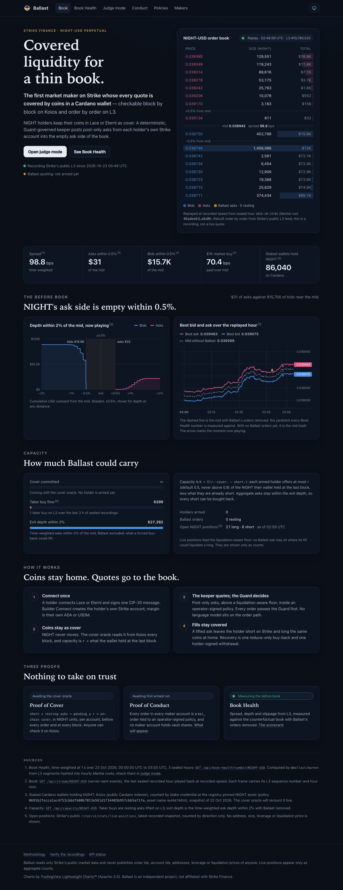

# Ballast

**Cardano holders as Strike's second market maker.**

> The first market maker on Strike whose every quote is covered by coins in a Cardano wallet — checkable block by block on Koios and order by order on L3.

NIGHT holders keep their coins in Lace or Eternl as cover. A deterministic, Guard-governed keeper posts covered, post-only asks from each holder's own Strike account into the empty ask side of the NIGHT-USD book. Nothing is pooled: there is no vault, and the coins never leave the holder's wallet.

**Live:** https://ballast-public-production.up.railway.app. **Judge mode** at [`/judge`](https://ballast-public-production.up.railway.app/judge) is the fastest way in. It is read-only and needs no wallet. Scrub any recorded second of the NIGHT-USD book, see the L3 sequence number it was rebuilt to, and recompute the hourly hash chain of the recordings in your own browser. The public host runs its own recorder, so its history starts at its first deploy (23 Oct 2026, 08:23 UTC). To run it locally instead, see [Run it](#run-it).



---

## The book today

NIGHT-USD is one of Strike's perpetual markets. Its bid side is deep, but **NIGHT's ask side is empty within 0.5% of the mid.** Measured from recorded data:

| NIGHT-USD, time-weighted, no Ballast orders | Value        | Source                                                                                                           |
| ------------------------------------------- | ------------ | ---------------------------------------------------------------------------------------------------------------- |
| Spread                                      | **98.8 bps** | Book Health over 23 Oct 2026, 00:49:51–02:42:35 UTC: 1,837,348 recorded lines, 0 bad lines, 0 L3 sequence breaks |
| Asks within ±0.5% of mid                    | **$31**      | same                                                                                                             |
| Bids within ±0.5% of mid                    | **$15,716**  | same                                                                                                             |
| $1K market buy, VWAP over mid               | **70.4 bps** | same                                                                                                             |
| $10K market buy, VWAP over mid              | **92.8 bps** | same                                                                                                             |
| Staked Cardano wallets holding NIGHT        | **86,040**   | Koios, counted by stake credential at the registry-pinned NIGHT asset, 22 Oct 2026                               |

For comparison, ADA-USD over the same window: 3.9 bps spread, $125,108 of asks within 0.5%, 2.5 bps for a $1K buy.

Reproduce the Book Health rows with `pnpm book-health -- --root data/recordings --from 2026-10-23T00:49:51Z --to 2026-10-23T02:42:35Z`. The API recomputes the same metrics over every sealed hour at `GET /api/book-health?symbol=NIGHT-USD`, and the site shows each number with its source.

## How it works

1. **Connect once.** A holder connects Lace or Eternl and signs one CIP-30 message. Builder Connect creates the holder's own Strike account with a Ballast API key. Margin is the holder's own ADA or USDM, deposited in-app with one signed transaction.
2. **Coins stay home as cover.** The NIGHT never moves. The cover oracle reads it from Koios every block. An account's capacity is `r ×` the NIGHT its wallet held at the last block (`r` defaults to 0.5 and never exceeds 0.9), less what it is already short.
3. **The keeper quotes; the Guard decides.** Post-only asks sit above a liquidation-aware price floor, inside an operator-signed policy that a deterministic replay (the Critic) has passed. Every action batch goes through the Guard, which evaluates every rule and fails closed. No language model sits on the order path.
4. **Fills stay covered.** A lifted ask leaves the holder short on Strike and long the same coins at home: covered. Recovery is one reduce-only buy-back and one holder-signed withdrawal.

Three proofs make the claim checkable without trusting Ballast:
- **Proof of Cover.** `short + resting asks + pending ≤ r × on-chain cover`, in NIGHT units, per account, before every order and at every block. Anyone can check the cover side on Koios.
- **Proof of Conduct.** Every order in every maker account is a `bal_` order tied to an operator-signed policy, and no maker account holds vault shares. A public auditor re-checks this every 60 seconds.
- **Book Health.** Spread, depth and slippage from L3, measured against the counterfactual book with Ballast's orders removed. Both books are measured against the counterfactual mid, so Ballast's quotes cannot move the yardstick they are judged by.

## Architecture

```
 STRIKE (public reads)                                     CARDANO
 /v2/l3/snapshot + /ws/l3 · /ws/price · /price/v2/*        Koios: cover per stake credential,
 /v2/markets · /v2/time · /stat/v1/stats/live-positions    every block
          │                                                         │
          ▼                                                         ▼
 ┌──────────────────┐   ┌──────────────────────────┐    ┌──────────────────────────┐
 │ RECORDER         │──▶│ MARKET MODEL             │    │ COVER ORACLE             │
 │ JSONL segments,  │   │ gap-checked L3 book,     │    │ NIGHT per stake          │
 │ sha256 manifest, │   │ mark and funding         │    │ credential, UTxO refs,   │
 │ hourly Merkle    │   │ replicas, liquidation-   │    │ block height             │
 │ roots, chained   │   │ aware floor, Book Health │    └────────────┬─────────────┘
 └───────┬──────────┘   └────────────┬─────────────┘                 │ capacity
         │ replay                    ▼                               ▼
         │              ┌─────────────────────────────────────────────────────────┐
         │              │ ENGINE (pure): ladder → floor and mark constraints →    │
         │              │ allocator → differ                                      │
 ┌───────▼──────────┐   └──────────────────────────┬──────────────────────────────┘
 │ CRITIC           │ signed policy                ▼
 │ deterministic L3 │──────────────▶ ┌─────────────────────────────────────────────┐
 │ replay, PASS     │                │ GUARD (pure, fail-closed, integer units)    │
 └──────────────────┘                └──────────────────────┬──────────────────────┘
                                                            ▼
                                     ┌─────────────────────────────────────────────┐
                                     │ SIGNER: route allowlist, server clock,      │
                                     │ rate budget with a cancel reserve → Strike  │
                                     └──────────────────────┬──────────────────────┘
                                                            ▼
                                     ┌─────────────────────────────────────────────┐
                                     │ RECONCILER: user stream, silent-drop        │
                                     │ detection, L3 attribution; KEEPER: cover    │
                                     │ loss → cancel → reduce-only buy-back        │
                                     └──────────────────────┬──────────────────────┘
                                                            ▼
 ┌──────────────────────────────────────┐   ┌──────────────────────────────────────┐
 │ PUBLIC API (read-only, keyless):     │──▶│ WEB: book · Book Health · judge mode │
 │ Book Health, replay, SSE book, roots │   │ · conduct · policies · makers        │
 └──────────────────────────────────────┘   └──────────────────────────────────────┘
 WATCHDOG (second host): its own L3, index and Koios reads → per-account cancel-all under a
 cancel-only signer policy.
```

The public API and site in this repository read only sealed recordings by default: every number they show traces to a recorded segment whose sha256 is rolled into an hourly RFC 6962 Merkle root, hash-chained to the hour before. With `BOOK_SOURCE=live` the API's current book switches to Strike's public L3 feed (one connection, relayed to every viewer over server-sent events).

## Safety invariants

Each one is enforced in code and covered by tests; none is ever weakened.
1. **Cover.** `short + resting asks + pending ≤ r × on-chain cover`, in NIGHT units, per account, before every order and at every block. On a breach: cancel first, then buy back reduce-only.
2. **Policy.** No order without an operator-signed, unexpired policy with a Critic PASS.
3. **Arming.** Dry-run by default; mainnet orders need an explicit arm flag, and a half-armed start is refused.
4. **Signer allowlist.** Only allowlisted routes are ever signed. The keeper never deposits, withdraws, touches vault, copy, grid, RFQ or TWAP routes, or uses order replace (it drops builder attribution). The watchdog's signer policy is cancel-only.
5. **Floor.** Every ask sits at or above the liquidation-aware floor, so no Ballast fill can be the trade that liquidates a long.
6. **No bid ahead** of the best non-Ballast bid without Strike's written opt-in; every buy is reduce-only.
7. **Integer units** (ticks, steps, micro-USD) in the engine and the Guard.
8. **Stale data cancels:** a stale index or mark, an L3 gap, stale cover or a dead stream.
9. **No blind retries.** Writes are asynchronous; silent drops are detected and a create is never duplicated. An unknown order counts as resting.
10. **Identifiers come only from config.** Language-model output is scanned for addresses and keys, and the model never holds keys.
11. **Keys** are encrypted at rest and never logged.

## Why there is no vault

A vault's NAV is on-venue only. Depositors have to trust the venue's accounting of the vault's positions, and nobody outside the venue can check what backs a quote. Ballast inverts that: the cover stays in holders' own wallets, where Koios shows it block by block, and every quote comes from the holder's own account, where L3 shows it order by order. There is no pooled capital and no off-venue position to take on faith.

## Honest limits

- **Capacity is finite and one-way.** Without Strike's opt-in to "recycling", Ballast exits only with reduce-only bids below the best bid, so it absorbs buy flow until committed cover or the aggregate cap binds. Aggregate short plus asks also stays within the asks available within 2% (about $27K in the recordings), so every short can be bought back.
- **The flow is thin.** Over the first sealed hours, L3 shows very few taker buys on NIGHT-USD. Book Health will show how much of a narrower book is used; nothing here assumes extra flow appears.
- **Regime.** If the ask side refills within Ballast's arm threshold (its first level must improve the best non-Ballast ask by at least 5 bps), Ballast stands down automatically.
- **The floor rests on a model.** The liquidation-aware floor uses a replica of Strike's mark price (held-out p99 error 0.77 bps on NIGHT). Strike has not confirmed the formula yet, so the floor carries a buffer of 10 bps plus twice that error.
- **Margin is separate from cover.** A rally raises the short's loss on Strike while the coins at home gain the same, but the home coins are not Strike margin. Margin bands, a combined loss stop and reduce-only buy-backs handle this; a holder can be bought back before a rally ends.
- **No cancel-on-disconnect on Strike.** If both the keeper and the watchdog fail, asks stay resting. They are covered, so the cost is bounded: selling above the floor while the price is higher still.
- **Early evidence.** Recording started on 23 Oct 2026. The "before" numbers cover hours, not weeks, and no mainnet order has been placed yet. The 14-day proof is still ahead.

## Status

| Milestone                                | Status                                                                                                                                                                                                                                   |
| ---------------------------------------- | ---------------------------------------------------------------------------------------------------------------------------------------------------------------------------------------------------------------------------------------- |
| 0 · Repo and research                    | Done                                                                                                                                                                                                                                     |
| M0 · Day-0 recorder                      | Live since 2026-10-23 00:49 UTC on three hosts (laptop, a second VPS, the public host), hourly roots verified, 0 L3 sequence gaps. Exit needs 24 h continuous.                                                                           |
| M1 · Strike client                       | Signed client, route allowlist, rate limits, user stream, silent-drop detection, reconcile, fake Strike. **D1 passed on Strike testnet** (batch, replace-batch, static-rule failure, post-only cross, silent drop of an unknown symbol). |
| M2 · Market model                        | Mark replica (held-out p99 0.77 / 0.65 bps), exact funding replica, liquidation-aware floor, Book Health, replay. Exit needs a held-out full day.                                                                                        |
| M3 · Engine, Guard, simulator            | Built. The Critic's replay of 7.8 recorded hours plus a 10-scenario stress library: 0 violations. Exit needs a 7-day replay.                                                                                                             |
| M4 · Governance and evidence chain       | Built: operator-signed policies, Critic gate, daemon-signed decision chain, `ballast verify`, CIP-20 anchoring. The first policy is live under a Critic PASS. The preprod anchor transaction is pending faucet funds.                    |
| M5 · Cardano onboarding and cover oracle | Built: CIP-30/CIP-8, Builder Connect, in-app deposit, witness merges, cover oracle. D10 (Koios cover at tip) measured binding and latency; D4, D5 and D9 wait on holder #0's funding.                                                    |
| M6 · Mainnet micro-tests                 | Builder code `Ballast` registered (D0). The keeper runs in DRY_RUN on mainnet data. D2, D3, D6, D7 and D8 follow D4/D5.                                                                                                                  |
| M7 · Holder #0 live                      | Keeper and watchdog built and chaos-tested against the fake; waits on M6.                                                                                                                                                                |
| M8 · Public surfaces                     | **Live** (link above): read-only API and site on recorded data; judge mode with in-browser chain verification.                                                                                                                           |
| M9 · 14-day proof                        | Not started                                                                                                                                                                                                                              |
| M10 · Submission                         | In progress                                                                                                                                                                                                                              |

Dated results, with the commands that reproduce them, are in [docs/evidence/EVIDENCE.md](docs/evidence/EVIDENCE.md). Problems found along the way, including where Strike's API behaved differently from its docs, are in [FRICTION.md](FRICTION.md).

## Run it

Requires Node ≥ 22.13 and pnpm 11.

```sh
pnpm install

# Record public NIGHT-USD and ADA-USD data (no keys, no writes) and verify it.
pnpm recorder                      # writes data/recordings/
pnpm recorder:verify               # re-hash every sealed segment, check the hourly chain

# Book Health from the recordings, as a report.
pnpm book-health -- --root data/recordings

# The read-only API (default http://127.0.0.1:8787) and the site (http://localhost:5173).
RECORDINGS_ROOT=data/recordings pnpm api:dev
pnpm web:dev                       # proxies /api to the API

pnpm web:build                     # static site in apps/web/dist
pnpm test && pnpm typecheck && pnpm web:typecheck && pnpm lint
```

Operator tooling (`pnpm ballast <command>`; keys are sealed under a host KEK and only their public halves are printed):

```sh
pnpm ballast keys new-operator --out ~/.ballast/keys/operator.json   # signs policies
pnpm ballast keys new-daemon   --out ~/.ballast/keys/daemon.json     # signs decision records
pnpm ballast policy draft --out draft.json                            # the plan's defaults
pnpm ballast policy sign --draft draft.json --key ~/.ballast/keys/operator.json --out-dir data/policies
# The keeper (DRY_RUN by default) sends each new policy to the Critic; only a PASS activates it.
pnpm ballast anchor --network preprod --anchor-key <file> --daemon-key <file> [--submit]
pnpm ballast export --out bundle --network preprod --daemon-key ~/.ballast/keys/daemon.json
pnpm ballast verify --bundle bundle --daemon-pubkey <hex> --recordings data/recordings
```

The API indexes only sealed (Merkle-rooted) hours, so it needs at least one completed recorded hour. To deploy, serve `apps/web/dist` as static files with `/api` proxied to the API, or build with `VITE_API_BASE=https://api.example` and list the site's origin in `CORS_ORIGINS`.

### API

Read-only and keyless: `GET`, `HEAD` and `OPTIONS` only, CORS enabled, ETags on every JSON response.

| Endpoint                                  | Returns                                                                                              | Cache                                |
| ----------------------------------------- | ---------------------------------------------------------------------------------------------------- | ------------------------------------ |
| `GET /api/book-health?symbol=&from=&to=`  | Book Health for a window of sealed hours (ISO or epoch ms), computed with `@ballast/market`'s replay | 1 day for a closed window, else 60 s |
| `GET /api/book-health/daily?symbol=`      | The same, per UTC day and per hour                                                                   | 60 s                                 |
| `GET /api/book/:symbol`                   | The current book as aggregated levels, with its L3 sequence number                                   | 1 s                                  |
| `GET /api/stream/:symbol`                 | The current book over server-sent events                                                             | none                                 |
| `GET /api/replay/:symbol?at=`             | The recorded book at a time (without `at`: the recorded windows)                                     | 1 day (windows: 60 s)                |
| `GET /api/series/:symbol?from=&to=&step=` | Bid, ask, mid, counterfactual mid, spread and depth series                                           | 1 day for a closed window            |
| `GET /api/recordings/roots`               | Hourly Merkle roots, segment hashes and the latest independent re-hash                               | 60 s                                 |
| `GET /api/capacity/:symbol`               | Capacity inputs: taker buy flow, exit depth, live positions as aggregate counts                      | 60 s                                 |
| `GET /api/cover/*`                        | `501 coming with the cover oracle`                                                                   | 60 s                                 |

| Variable                            | Default             | Meaning                                                                                           |
| ----------------------------------- | ------------------- | ------------------------------------------------------------------------------------------------- |
| `RECORDINGS_ROOT`                   | `data/recordings`   | The recorder's output directory                                                                   |
| `API_PORT`, `API_HOST`              | `8787`, `127.0.0.1` | Listen address                                                                                    |
| `BOOK_SOURCE`                       | `replay`            | `replay` plays the last sealed hour back at recorded speed; `live` relays Strike's public L3 feed |
| `CORS_ORIGINS`                      | `*`                 | `*` or a comma-separated origin list                                                              |
| `API_SYMBOLS`                       | `NIGHT-USD,ADA-USD` | Markets served                                                                                    |
| `ARCHIVE_FRAME_MS`, `ARCHIVE_HOURS` | `5000`, `24`        | Scrubber frame spacing and how many hours keep frames                                             |

### Holder routes (off by default)

With `HOLDER_ROUTES=1` the API also serves `/api/holder/*` for `/join` and `/me`: Sign-In-With-Cardano sessions, Builder Connect with a key the server generates and seals (only its public half goes to Strike), and deposit and withdraw calls through the `HOLDER_PRESENT` profile, each needing a fresh holder proof from the wallet. This turns the process into a signing role: run it only outside Strike's restricted jurisdictions, never on a read-only host. Against Strike mainnet it also needs `BALLAST_ARM=1`. The morning runbook for the wallet checks is [docs/dayone.md](docs/dayone.md).

## Claims and how to check them

| Claim                                                                                                 | Check                                                                                                                                                    |
| ----------------------------------------------------------------------------------------------------- | -------------------------------------------------------------------------------------------------------------------------------------------------------- |
| NIGHT's spread is about 99 bps; about $31 of asks sit within 0.5% of mid against about $15.7K of bids | `GET /api/book-health?symbol=NIGHT-USD`, or `pnpm book-health` on the recordings                                                                         |
| A $1K market buy pays about 70 bps over mid                                                           | same, `slippageBps.buy.1000`                                                                                                                             |
| 86,040 staked Cardano wallets hold NIGHT                                                              | Koios, stake credentials holding the registry-pinned NIGHT asset (policy `0691b2fecca1ac4f53cb6dfb00b7013e561d1f34403b957cbb5af1fa`, asset `4e49474854`) |
| The recordings have not been altered since they were sealed                                           | `pnpm recorder:verify`; or judge mode, which recomputes every hourly root and chain link in the browser                                                  |
| The public API shows no order ids, addresses or house internals                                       | `apps/api/test/server.test.ts` scans the book, replay, Book Health and capacity responses for every L3 order and taker id in the fixture                 |
| Ballast's quotes are covered                                                                          | Proof of Cover, once the cover oracle and holder #0 are live (M5, M7)                                                                                    |

## Repository

```
packages/core           canonical JSON (RFC 8785), hashing, integer units, the QuotePolicy schema
packages/evidence       segment writer, manifest, Merkle roots, gzip, SQLite evidence store,
                        CIP-20 anchors, evidence bundles
packages/strike-client  public reads, gap-checked L3 book and feed, signed client, route allowlist,
                        rate budget, user stream, silent-drop detection, reconcile
packages/fake-strike    a fake Strike server for tests (trading, Builder Connect, deposit, withdraw)
packages/market         market model: book, Book Health, replay, mark and funding replicas, floor
packages/engine         ladder, floor and mark constraints, allocator, differ (pure)
packages/guard          28 fail-closed rules over integer units (pure)
packages/sim            deterministic L3 replay simulator and the Critic's stress library
packages/governance     sealed keys, policy signing and renewals, Critic gate, decision chain
packages/cover          Koios cover oracle, stake-credential binding, Proof of Cover
packages/cardano        CIP-30 wallets, CIP-8 verification, holder messages, witness merges
packages/ops            arming, hosting rule, signed heartbeats, kill confirmation, alerts
apps/recorder           the day-0 recorder
apps/keeper             the keeper daemon (host A)
apps/watchdog           the cancel-only watchdog (host B)
apps/cli                ballast verify | cover | book-health | dayone | keys | policy | anchor | export
apps/api                the read-only public API (it also serves the built site)
apps/web                the public site (Vite, React, TradingView Lightweight Charts)
deploy/                 systemd units, env examples, the public host's Dockerfile
docs/                   day-one runbook, EVIDENCE.md, screenshots
```

## Data policy

Ballast reads only Strike's public market data. Live positions are read only as a safety input to the price floor and are published only as aggregate counts. The recorder stores live positions without any address, handle or account id. No public surface shows order ids, client ids, account ids, addresses, or the leverage, liquidation price or inventory of any participant. Public wording stays neutral: NIGHT's ask side is empty within 0.5%.

Ballast is an independent project, not affiliated with Strike Finance.
